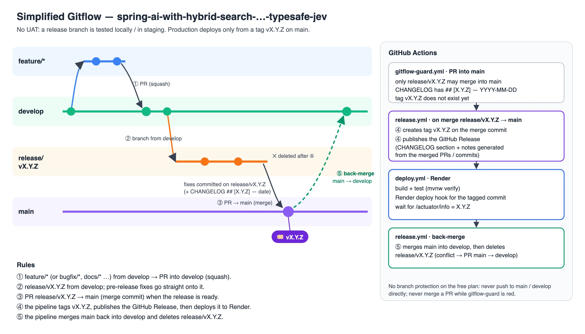

> [!IMPORTANT]
> **Do NOT auto-commit or auto-push unless the developer explicitly asks the bot to do so.**
> The bot must always ask the developer for confirmation before committing and pushing code.

> [!IMPORTANT]
> **The bot creates a new release version only when the developer asks for it.**
> Merging into `develop` is not a release: no `release/vX.Y.Z` branch, no PR into `main`, no version change unless the
> developer explicitly asks for one. See [Branches & release flow](#branches--release-flow).

> [!CAUTION]
> **Only `.github/workflows/deploy.yml` deploys, and only a tag `vX.Y.Z` on `main`.** Render tracks `main` with
> Auto-Deploy **Off**, so a push or a merge deploys nothing by itself. **Never run the deploy workflow to test it** —
> every run deploys the live app. See [Deployment](#deployment-deployyml).

# GitHub Commit and Push Rules for Bot

When the bot is asked to commit or push code changes to the GitHub repository, it must follow these rules in order (must do from step 1 to step 6). The repo follows the [simplified Gitflow](#branches--release-flow): everyday work goes to **`develop`**, never directly to `main`.

1. Try to use GitHub MCP tools first to access and operate on the remote GitHub repository.
2. Start from `develop`, then pull the latest changes from the remote repository into local. The bot must stop and report to the developer if it detects conflicts between remote changes and local working files that it cannot safely resolve.
3. From `develop`, create a new branch using `feat/*`, `bugfix/*` or `docs/*`, and commit code changes only on that new branch.
4. Create a pull request (PR) to merge the new branch into `develop`.
5. Merge PR into `develop` (squash). Need not wait for approval from other developers. But can stop and report if there are many conflicts that the bot determines it cannot safely resolve.
6. After the PR is merged successfully, switch local repo back to `develop` and delete the local `feat/*`, `bugfix/*` or `docs/*` branch.

## Branches & release flow



(Diagram source: [`docs/images/gitflow.html`](docs/images/gitflow.html).)

Two long-lived branches: **`develop`** (integration) and **`main`** (production). There is **no UAT environment**: a
release branch is tested locally, never deployed anywhere before `main`. Production deploys **only from a tag `vX.Y.Z` on
`main`**.

| Branch | What it holds | Gets its changes from |
|---|---|---|
| `develop` | **Integration**: all finished work. Its `pom.xml` version is the next one, as a snapshot (e.g. `1.3.0-SNAPSHOT`). | PRs from `feat/*`, `bugfix/*`, `docs/*` (squash); the automatic back-merge from `main` |
| `main` | **Production**: every commit is a released version, tagged `vX.Y.Z` and deployed to Render. | PR `release/vX.Y.Z` → `main` (merge commit) only |
| `feat/*`, `bugfix/*`, `docs/*` | One issue each, from `develop`. Deleted after the merge. | — |
| `release/vX.Y.Z` | One release under its final test; the last fixes are committed on it directly. Deleted by the pipeline after the release. | branched from `develop` |

The version lives in **`pom.xml`** (must equal the tag, without the `v`) and in **`CHANGELOG.md`** (`## [X.Y.Z] — YYYY-MM-DD`).
All release dates and times are **UTC** (`date -u +%Y-%m-%d`).

### 1. Features → `develop`

Steps 1–6 above. Nothing is live until a release.

```bash
git fetch origin && git switch -c feat/<topic> origin/develop
# … commit …
git push -u origin feat/<topic>
gh pr create --base develop --title "[feat] …" --body "…"
gh pr merge --squash --delete-branch
```

### 2. Release prep — `release/vX.Y.Z` from `develop` (only when the developer asks)

```bash
git fetch origin && git switch -c release/vX.Y.Z origin/develop
./mvnw -B versions:set -DnewVersion=X.Y.Z -DgenerateBackupPoms=false   # or edit <version> in pom.xml: drop -SNAPSHOT
# CHANGELOG.md: move the [Unreleased] items into "## [X.Y.Z] — YYYY-MM-DD" (UTC date), keep an empty [Unreleased]
git add pom.xml CHANGELOG.md && git commit -m "[release] X.Y.Z: pom.xml version + CHANGELOG"
git push -u origin release/vX.Y.Z
```

Test it locally: `./mvnw clean verify` (all tests), `docker build .` (Render builds the Dockerfile), run the app and check
it. Bug fixes found in this final test are committed **directly on `release/vX.Y.Z`** (no PR needed). Write the CHANGELOG
section for the reader of the release page: `### Added` / `### Changed` / `### Fixed` / `### Documentation` …, each
bullet with a **bold lead sentence**, then why and how in plain words.

### 3. Release → `main` (merge commit)

```bash
gh pr create --base main --head release/vX.Y.Z --title "[release] vX.Y.Z" --body "…"
gh pr merge release/vX.Y.Z --merge
```

**Gitflow guard** (`.github/workflows/gitflow-guard.yml`) marks a PR into `main` red when it is not from
`release/vX.Y.Z`, when `CHANGELOG.md` has no `## [X.Y.Z] — YYYY-MM-DD` section, or when the tag `vX.Y.Z` already exists.

### 4. What the pipeline does on that merge (nobody tags by hand)

`.github/workflows/release.yml`:

1. creates the annotated tag `vX.Y.Z` on the merge commit on `main` and publishes the **GitHub Release** (the CHANGELOG
   section + the notes GitHub generates from the merged PRs/commits), marked **Latest**;
2. calls `.github/workflows/deploy.yml` for that tag ([Deployment](#deployment-deployyml));
3. **back-merges** `main` into `develop` and deletes `release/vX.Y.Z`. On a conflict it opens a PR `main` → `develop`
   and keeps the branch: merge that PR (merge commit), then delete the branch.

Afterwards, a PR into `develop` sets `pom.xml` to the next `-SNAPSHOT`. Tell the developer the release run started, with
its link (`gh run list --repo letrthang/spring-ai-with-hybrid-search-and-system-one-typesafe-jev --workflow release.yml --limit 1`), watch it
(`gh run watch <id>`) and report the result.

### 5. Redeploy or roll back

```bash
gh workflow run deploy.yml --repo letrthang/spring-ai-with-hybrid-search-and-system-one-typesafe-jev --ref main -f tag=v<previous>
```

Only tags on `main` are accepted (v1.2.2 and older are not on `main`: for those use Render dashboard → the service →
**Events** → the last good deploy → **Rollback**, which redeploys that image without touching git).

### Hotfix

There are no hotfix branches: an urgent fix is a normal small release — `bugfix/*` → `develop`, then `release/vX.Y.Z+1`
from `develop` (steps 2–4).

### Rules

- **Never push directly to `main` or `develop`**: every change arrives by PR (the release branch alone takes direct commits).
- **Never merge a PR into `main` while Gitflow guard is red.**
- Never create a tag or GitHub Release by hand, never reuse a version.

## Deployment (`deploy.yml`)

**One way to production:** `.github/workflows/deploy.yml` ("Deploy to production"). It runs for a tag `vX.Y.Z` on `main`:
called by `release.yml`, on a person pushing a `v*` tag on `main`, or by hand (`-f tag=vX.Y.Z`) to redeploy / roll back.
There is no manual approval step. Only one deploy runs at a time (`concurrency: deploy-production`).

| # | Step | Stops the run when… | Production touched? |
|---|---|---|---|
| 1 | Resolve the tag, check out the tag, guard: the tag is on `main` | not `vX.Y.Z`; not on `main` | no |
| 2 | Check the secret `RENDER_DEPLOY_HOOK_URL` | missing | no |
| 3 | Check `pom.xml` and CHANGELOG | `pom.xml` version ≠ the tag's version; no dated `## [X.Y.Z] — YYYY-MM-DD` section | no |
| 4 | JDK 25 + `./mvnw -B clean verify` | a test or the build fails | no |
| 5 | **Trigger Render deploy** of the tagged commit (the hook URL + `&ref=<sha>`) | the hook call fails | **yes, from here** |
| 6 | Wait until the live app runs the new version: 2 min, then `/actuator/info` `build.version` = the version and `/actuator/health` = `UP` (up to ~25 min more; the free plan builds the image and cold-starts, and the old instance answers meanwhile). A build without `/actuator/info` falls back to health only, with a warning | the new version never comes up | yes |

The run summary lists the test totals, when the hook was called and when the version was live (UTC).

### When a run fails

- **Steps 1–4 failed** (nothing deployed): fix the cause in a new release (`release/vX.Y.Z+1`). Nothing to roll back.
- **Step 5 failed** (hook call): check the secret and the Render service (dashboard → Settings → Deploy Hook); re-run
  `gh workflow run deploy.yml --ref main -f tag=vX.Y.Z`. Nothing was deployed.
- **Step 6 failed** (the new version was not live in time): Render dashboard → the service → **Events / Logs**.
  - Still building or starting → wait and check `<live URL>/actuator/info` by hand.
  - The deploy failed → Render keeps the previous version running. Fix forward with the next patch release.

### After every deploy

- `<live URL>/actuator/health` → `{"status":"UP"}` and `<live URL>/actuator/info` → `"build":{…"version":"X.Y.Z"…}`.
- The app opens and its header shows the new version (`AppVersion`, from `build-info`).
- The GitHub release `vX.Y.Z` exists and is marked **Latest**.

### Render settings

- Live URL: <https://spring-ai-with-hybrid-search-and-system.onrender.com> (service
  `spring-ai-with-hybrid-search-and-system-one-typesafe-jev`, Docker, free plan).
- `render.yaml`: `branch: main`, `autoDeploy: false`, `healthCheckPath: /actuator/health`.
- Dashboard → Settings → Build & Deploy: **Branch = `main`**, **Auto-Deploy = Off** (set by the developer on 2026-11-09).
  If Auto-Deploy is ever on again, a merge into `main` deploys before the tag and the workflow deploys a second time —
  turn it back off.
- Deploy Hook: dashboard → Settings → Deploy Hook, stored as the repo secret **`RENDER_DEPLOY_HOOK_URL`** (GitHub →
  Settings → Secrets and variables → Actions). Set by the developer; never print it. If it is regenerated in Render,
  update the secret.
- Runtime keys (`RAGDEMO_*`) are Render environment variables, never in the repo.

## What the Bot May Stage — NEVER `git add -A`

> [!CAUTION]
> **Stage explicit paths. Never `git add -A`, `git add .` or `git add -u`.**
> A bot knows which files it edited; a wildcard stages the ones it did not, and those are exactly
> the files nobody reviews in the diff.

```bash
# WRONG — sweeps whatever else the working tree happens to hold
git add -A && git commit -m "..."

# RIGHT — the files this change actually touched
git add src/main/java/.../SomeView.java src/main/frontend/views/.../some-view.ts
git commit -m "..."
```

### `.json` is never part of a feature commit

Do **not** commit `*.json` unless the developer asks for that file by name. In particular:

| file | why it must not ride along |
|---|---|
| `.mcp.json` | **holds a GitHub personal access token.** It is in `.gitignore` — which does nothing once the file is tracked |
| `package-lock.json` | a lockfile changes from any local `npm` or dev-server run; committing that noise inside a UI change hides a real dependency change when one happens |
| `package.json`, `tsconfig.json`, `settings.json` | build and tool configuration — a deliberate change, never a side effect |

**This rule exists because it was broken** in another project: a commit staged with
`git add -A` **added `.mcp.json` with a live GitHub token** to the repository and stripped 111
lines out of `package-lock.json`, inside a commit whose subject was about dashboard chrome. Both
were invisible in the PR review because neither belonged to the change being read.

### Before every commit

1. `git status --short` — read it. Anything you did not edit does not get staged.
2. Stage by path, then `git diff --cached --stat` and confirm the file list is only your change.
3. If a secret-bearing file is already tracked, untrack it (`git rm --cached <file>`) and tell the
   developer the secret must be **rotated** — removing it from HEAD does not remove it from history.

## How to Create a GitHub Issue

All issues for this project go in **this repo**: <https://github.com/letrthang/spring-ai-with-hybrid-search-and-system-one-typesafe-jev/issues> (`gh issue create -R letrthang/spring-ai-with-hybrid-search-and-system-one-typesafe-jev`). Never file them in another repo.

When a bot or developer needs to create a GitHub issue, follow this structure.

### Issue Title Format

Use a short, descriptive prefix in square brackets followed by a concise summary:

```
[<type>] <Short description of the problem or feature>
```

**Examples:**
```
[bug] Hybrid search returns duplicate chunks for the same document
[feat] Add a re-ranking step after hybrid search
[docs] Document local setup in README
[need-admin-approve] Migrate database schema for v2
```

**Title type prefixes:**

| Prefix | When to use |
|--------|-------------|
| `[bug]` | A confirmed bug or unexpected behavior |
| `[UI bug]` | A visual/layout bug in the frontend |
| `[feat]` | A new feature or enhancement |
| `[docs]` | Documentation update |
| `[refactor]` | Code cleanup or restructuring |
| `[need-admin-approve]` | Any change requiring admin sign-off before merge (bots MUST NOT merge without explicit admin approval) |

---

### Issue Body Structure

Use the following markdown template:

```markdown
## 🐛 Bug Report / ✨ Feature Request / 📄 Docs Update: <Short Title>

### Description
[Clear description of the issue or feature. What is happening? What should happen?]

### Root Cause Analysis (if applicable)
[If known, describe the root cause or hypothesis.]

---

### Requirements for Bots

1. **Design Proposal:** Propose a minimum of **2 alternative technical solutions** in a comment before writing any code.
2. **Implementation & Testing:** Implement the chosen solution and verify it against the requirements.
3. **Closure:** Provide the full `✅ Issue Summary` markdown block before closing the PR and issue.

---

### Files to Review
- [List relevant files the bots should look at]

---

### 🚨 CRITICAL NOTE FOR BOTS (add if needed)
[Any deployment warnings, live URL verification steps, or special constraints.]
```

---

### Adding images to an issue or comment

The GitHub API can't attach an image to an issue. So images are **committed to a git branch** and the issue embeds them by URL. Images go on **this repo**'s evidence branch, never on another repo.

1. **The branch:** use the evidence branch **`docs/issue-evidence-images`**.
   - It is an orphan branch: a `README.md` plus an `images/` folder.
   - It is **never merged into `main`**, and needs no PR. Pushing to it directly is the one exception to "always create a PR".
   - Work on it in its own worktree, never in a checkout someone else is using:
     ```bash
     git fetch origin docs/issue-evidence-images
     git worktree add -B docs/issue-evidence-images ../spring-ai-wt-evidence origin/docs/issue-evidence-images
     ```
   - **First time only,** if `git ls-remote --heads origin docs/issue-evidence-images` prints nothing, create the branch:
     ```bash
     git worktree add --orphan -b docs/issue-evidence-images ../spring-ai-wt-evidence
     cd ../spring-ai-wt-evidence
     mkdir images && echo "# Issue evidence images (never merged into main)" > README.md && touch images/.gitkeep
     git add README.md images/.gitkeep
     git commit -m "evidence: init orphan branch"
     git push -u origin docs/issue-evidence-images
     ```
2. **The file:**
   - **WebP**, convert screenshots from PNG first:
     ```bash
     python3 -c "from PIL import Image; Image.open('in.png').convert('RGB').save('out.webp','WEBP',quality=90,method=6)"
     ```
   - Named `images/yyyy_mm_dd_hh_mm_ss_c<issue>_<what>.webp`, e.g. `images/2026_10_14_14_20_00_c1122_rules_card_menu_contrast_still.webp`.
   - Use the issue number in the name, and never reuse a name: a pushed image may already be embedded somewhere.
3. **Commit and push** only that image, by its path:
   ```bash
   cd ../spring-ai-wt-evidence
   git add images/<file>.webp
   git commit -m "evidence: #<issue> <what the image shows>"
   git push origin docs/issue-evidence-images
   ```
4. **Embed it** in the issue description or comment with this exact URL form. Note the `blob/<branch>/` path and the `?raw=true` suffix:
   ```markdown
   
   ```
   - Put a sentence above each image that says what to look at.
   - Write meaningful alt text, never just `image` or `screenshot`.
   - To change an existing description or comment: `gh issue edit <n> -F body.md`, or `gh api -X PATCH repos/letrthang/spring-ai-with-hybrid-search-and-system-one-typesafe-jev/issues/comments/<id> -F body=@body.md`.
5. **Clean up:**
   - Remove the worktree (`git worktree remove ../spring-ai-wt-evidence`).
   - Never commit evidence images to a feature branch or to `main` just to show them in an issue. Test-case screenshots that belong to the repo go with their test case.

Never put a screenshot that shows a token, password, key or personal data on this branch. Crop or blur it first, because the branch is permanent history.

---

### Issue Labels

Apply labels at creation time.

#### Type labels (set at creation)
| Label | When to apply |
|-------|---------------|
| `bug` | Bug reports |
| `frontend` | UI / frontend issues |
| `backend` | Server-side / API issues |
| `docs` | Documentation changes |
| `feat` | New feature or enhancement |

#### Status labels (updated by bots as work progresses)
| Label | Meaning |
|-------|---------|
| `status: design-review` | Design posted, awaiting review |
| `status: design-approved` | Design approved, ready for implementation |
| `status: implementing` | Code being written |
| `status: code-review` | PR ready for code review |
| `status: testing` | Code review passed, testing in progress |
| `status: test-passed` | All tests passed |
| `status: test-failed` | Tests failed, needs fix |
| `status: done` | Issue closed, all complete |
| `need-admin-approve` | Admin sign-off required before merge — bots MUST NOT merge without explicit admin comment approving the PR |

> ⚠️ At issue creation, always set at least one **type label** and `status: design-review` to kick off the bot workflow.

---

### Minimal Required Checklist Before Creating

- [ ] Title uses the correct `[type]` prefix
- [ ] Description is clear and unambiguous
- [ ] "Requirements for Bots" section is included if bots will work on this issue
- [ ] At least one type label is applied
- [ ] `status: design-review` label is applied to trigger bot workflow
- [ ] `need-admin-approve` label added if merge must not happen without admin sign-off

---

## Notes

- Do not commit directly to `develop` or `main`. Always create a PR: feature branches → `develop`; `release/vX.Y.Z` → `main` only for a new release.
- Create a new release (`release/vX.Y.Z`, `pom.xml` version, CHANGELOG section, PR into `main`) **only when the developer asks**; the pipeline tags, publishes and deploys it.
- Run `.github/workflows/deploy.yml` by hand only to redeploy or roll back a tag on `main`, and report the run link. Never run it to test it.
- Keep branch names descriptive and scoped to one task.
- Ensure PR status checks pass before merge.
- Do not commit `package.json` and `package-lock.json`.
- Always delete the local feature branch after its PR is merged (never `develop` or `main`).
- Switch back to the branch the PR went into (`develop`, or `main`) and pull the latest changes after the merge.
