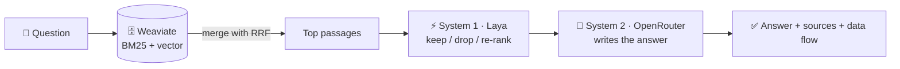

<h1 align="center">RAG demo with System 1 &amp; 2 and Hybrid Search</h1>

<p align="center">
  <b>A small demo / training app: how RAG works with System 1, System 2 and the Weaviate vector DB</b><br>
  <i>Built with Spring AI and Vaadin. Weaviate finds the passages (BM25 + vector), a fast System 1 model keeps the
  useful ones, an LLM writes the answer — and every step is shown. Switch on <b>🛠 AI agentic mode</b> and the LLM
  calls tools itself: it decides what to search, how often, and when it can answer.</i>
</p>

<p align="center">
  <a href="LICENSE"></a>
  
  
  
  
  
  <a href="https://huggingface.co/spaces/letrthang/aimtas-system-one-decision-model-laya"></a>
  
  
  
</p>

<p align="center">
  <a href="https://spring-ai-with-hybrid-search-and-system.onrender.com"><b>▶ Live demo</b></a> ·
  <a href="#how-it-works">How it works</a> ·
  <a href="#-agentic-mode">🛠 Agentic mode</a> ·
  <a href="#what-you-need-to-start-the-web-app">What you need</a> ·
  <a href="#5-minute-demo-script">5-minute demo</a> ·
  <a href="#run-locally">Run locally</a> ·
  <a href="#deploy-to-render">Deploy</a> ·
  <a href="architecture.md">Architecture</a>
</p>

> ⚡🤗 **System 1 runs on [Laya — a System One decision model on Hugging Face](https://huggingface.co/spaces/letrthang/aimtas-system-one-decision-model-laya)**
> Public, free, no key: typed questions in, calibrated probabilities out. **[▶ Try it on the Space](https://huggingface.co/spaces/letrthang/aimtas-system-one-decision-model-laya)**

---

## How it works



1. **Retrieve:** Weaviate finds passages two ways, by keywords (**BM25**) and by meaning (**vector**), and the app merges
   both lists (**Reciprocal Rank Fusion**).
2. **System 1** (fast, small decision model): scores each passage (relevant? answers the question? prompt injection?),
   drops the bad ones and re-ranks the rest.
3. **System 2** (big LLM): writes the answer from the passages System 1 kept, citing them `[1]`.

**Two ways to answer — you choose with a switch in 💬 Chat:**

| | Fixed pipeline (default) | 🛠 AI agentic mode |
|---|---|---|
| Who decides the steps | the app: always search → ⚡ check → 🧠 write | 🧠 System 2: it calls **tools** as often as it needs, then answers |
| Tools | — | `search_passages` (Weaviate + ⚡ System 1 check) · `find_learned_answer` (🧠 verified answers) · `recent_questions` (💾 H2 chat history) |
| Good for | one clear question | questions that need several look-ups, e.g. *"Compare PCR and qPCR — what is different?"* |
| Spring AI | `DocumentRetriever` → `DocumentPostProcessor` → `ContextualQueryAugmenter` → `ChatClient` | `@Tool` → `ToolCallback`s, the tool-calling loop run by the app against the `ChatModel` (≤ 6 calls) |

In both, the answer is verified by ⚡ System 1 and **learned** for next time (🧠 self-learning), and 🔀 Data flow shows
every step — in agentic mode, every round and tool call.

| Step | What happens | Code |
|---|---|---|
| 1. Retrieve | Weaviate searches by **keywords (BM25)** and by **meaning (vector)** at the same time | `HybridRetriever` |
| 2. Merge | **Reciprocal Rank Fusion**: `1/(60+rank)` from each list, added | `RrfFusion` |
| 3. Filter | **System 1** (Laya) scores each passage: relevant? answers? prompt injection? | `SystemOneFilter`, `SystemOneReranker` |
| 4. Generate | **System 2** (a free OpenRouter LLM) answers from the kept passages and cites them `[1]` | `SystemTwoClient` |
| 🛠 Agent | **AI agentic mode**: System 2 calls the tools above itself, in a loop, then answers | `RagAgent` |
| — | The whole flow, top to bottom, with a trace for 🔀 Data flow | `RagService` |

The app has three pages: **💬 Chat** (answers with 📚 Sources, 🔬 Trace and a 🔀 Data flow dialog that shows every step
with timings; the **🛠 Agentic mode** switch), **🔎 Search Data** (compare BM25 / Vector / Hybrid, double-click a row to see the stored record) and
**🔑 Key Management**. Every important part has an **ℹ️** button that explains it — what it is, what it does, how it
links to the rest, and a little theory. The whole page, hints included, is in 🇬🇧 English, 🇻🇳 Tiếng Việt and
🇯🇵 日本語 (dropdown at the top right). Plan: issue [#2](https://github.com/letrthang/spring-ai-with-hybrid-search-and-system-one-typesafe-jev/issues/2) · design: [architecture.md](architecture.md).

**Live demo:** <https://spring-ai-with-hybrid-search-and-system.onrender.com> (free instance: the first visit after 15
idle minutes takes about a minute).

## What you need to start the web app

You only need **two accounts**. Everything else works out of the box.

| | Service | Default (we provide) | What you need | Bring your own? |
|---|---|---|---|---|
| 🗄️ | **Vector DB** — Weaviate | — | a free **Weaviate Cloud** cluster: its **URL** + an **Admin API key** | any Weaviate you run yourself (URL + key) |
| 🧠 | **System 2** — LLM that writes the answer | **OpenRouter**, free `…:free` models | an **OpenRouter API key** (free) | any OpenAI-compatible endpoint (e.g. Ollama) |
| ⚡ | **System 1** — decision model that filters passages | **Laya** public demo route on Hugging Face — **no key** | nothing | your own Laya server |
| ☁️ | **Hosting** | Render (free plan) | nothing to run locally | — |

Enter everything in the app's **🔑 Key Management** menu (System 2 models are picked from a dropdown — 🆓 free first,
💲 paid below). Keys are saved in the app's local file DB and read on every API call. Default keys can come from
environment variables (`RAGDEMO_WEAVIATE_URL`, `RAGDEMO_WEAVIATE_KEY`, `RAGDEMO_OPENROUTER_KEY` — on Render:
service → **Environment**); a key saved in 🔑 Key Management wins over them, 🗑 Clear goes back to them. Render's disk
is not persistent, so saved keys are lost on a restart or redeploy; the environment defaults stay.

### Quick start

1. Open 🔑 **Key Management**, enter the two keys (pick models from the dropdown — free ones first).
2. 🔎 **Search Data** → 📥 **Load sample data** (biotech, physics and a fish-farm handbook).
3. 💬 **Chat** → try *"What does a RAS system do?"* and open 📚 Sources and 🔀 Data flow.

### Get the two keys

1. **OpenRouter:** sign up at [openrouter.ai](https://openrouter.ai/) → **Keys** → **Create key** (`sk-or-v1-…`). Free models still need a key; they have low per-minute and per-day limits.
2. **Weaviate Cloud:** sign in at [console.weaviate.cloud](https://console.weaviate.cloud/) → create a free **Sandbox** cluster → copy the **REST endpoint** and an **Admin** API key.
   The app creates its collection and loads the sample data, so a read-only key is not enough.
   Embeddings come from Weaviate's built-in vectorizer — no extra embedding key.

### Keys you do **not** need

| Not needed | Why |
|---|---|
| Laya / Hugging Face token | the default System 1 uses the public, keyless route |
| OpenAI / Cohere embedding key | Weaviate's built-in vectorizer makes the vectors |
| Render Deploy Hook | Repo secret `RENDER_DEPLOY_HOOK_URL`; the release workflow `.github/workflows/deploy.yml` (run by hand) deploys the `release` branch through it |
| Database password | H2 is a local file inside the app |

### Sample data

📥 **Load sample data** (in 🔎 Search Data) loads **3,000 passages — 1,000 each in 🇬🇧 English, 🇻🇳 Vietnamese and
🇯🇵 Japanese** (`sample-data/en|vi|ja`, 110 topics × 3 languages): biotech basics (cells, enzymes, DNA, RNA, PCR / qPCR,
CRISPR, sequencing, vaccines, mRNA, chromatography, bioreactors…), physics basics (mechanics, waves, heat, electricity,
optics, atoms, lasers, quantum ideas, relativity…), recirculating aquaculture systems (RAS: filters, biofilter, oxygen,
CO₂, pH, sensors, alarms, species, energy, AI monitoring…), and office notes with an off-topic canteen menu and a
planted prompt injection — for System 1 to drop. Search keeps to the language of the question, so an English question
gets English passages (one fact, not the same fact three times).

## System 1: default or your own

🤗 **[Laya on Hugging Face](https://huggingface.co/spaces/letrthang/aimtas-system-one-decision-model-laya)** — open the Space to try the model in your browser.

**Default — nothing to do.** The app calls the public Laya Space:

```
POST https://letrthang-aimtas-system-one-decision-model-laya.hf.space/demo/systemone
```

- No key. Limits: **10 calls / min** per IP, 1–3 questions and 2 KB per call. The app checks at most 4 passages per question, so about 2 questions a minute.
- The Space sleeps when idle and takes about a minute to wake up.
- **System 1 is required** — see [When a service is down](#when-a-service-is-down).

**Your own (optional):** run Laya yourself (`pip install "laya[serve]"` then `laya-serve` → `http://localhost:8000`) and set that URL in 🔑 Key Management → System 1 → Advanced.

## System 2: default or your own

**Default:** OpenRouter at `https://openrouter.ai/api/v1` with free models. Only the API key is needed.

**Your own (optional):** any OpenAI-compatible endpoint, e.g. Ollama (`http://localhost:11434/v1`). Set the base URL and model in 🔑 Key Management → System 2 → Advanced.

> `localhost` URLs only work when the web app runs on your own machine, not on Render.

## 🧠 Self-learning

The app learns from its own answers — carefully. After an answer, ⚡ **System 1 verifies it** (does it answer the
question, is it backed by a passage it cites, no prompt injection); only then is the question + answer saved to Weaviate as a
**learned** object (`kind = learned`, kept apart from the passages — the free Weaviate Cloud plan allows one collection,
and every passage search filters `kind = passage`). When someone later asks a very similar question in the same
language, System 1 checks the stored answer fits the new question and the app returns it at once — ♻️ no System 2 call.
The 🧭 diagram shows both lines; 🔎 Search Data → 🧠 Learned answers lists (and forgets) what was learned.

## 🛠 Agentic mode

A switch next to **🔎 Ask**. Off (default): the fixed pipeline above. On: 🧠 **System 2 gets tools and decides itself
what to look up** — how often and with which words — then answers:

| Tool | What it does |
|---|---|
| `search_passages(query)` | 🗄️ Weaviate hybrid search in the question's language; ⚡ System 1 checks every passage first, so the agent only ever sees kept ones |
| `find_learned_answer(question)` | 🧠 a learned answer, if it is the same or close and ⚡ System 1 says it fits |
| `recent_questions(limit)` | 💾 the newest questions asked in the app (H2, read-only) |

The app runs the loop itself (Spring AI `@Tool` methods → `ToolCallback`s, sent to the `ChatModel`; the model replies
with the calls it wants): at most **6 tool calls**, the last round offers no tools so the model has to answer. Every
round and tool call is a hop in 🔀 Data flow and a line in 🔬 Trace; the 🧭 diagram shows the tool loop above System 2.
The answer is then verified and learned like any other. Try **"Compare PCR and qPCR — what is different?"** — the
agent usually searches twice. Not every free model supports tools: those are skipped like a busy one.

## When a service is down

This is a demo of RAG with **all three services**, so all three are **required**: ⚡ **System 1**, 🧠 **System 2** and 🗄️ **Weaviate**. The 💬 Chat page shows a status pill for each: 🟢 Ready, 🟡 Waking up / busy / no data, or 🔴 Down.

If any one is not 🟢 Ready:
- a ⚠️ **warning banner** says which system is down and why (e.g. "System 1 is waking up, about 1 minute", "System 2: invalid key", "Weaviate: collection is empty — load sample data in 🔎 Search Data");
- the question box and **Ask** button are **disabled**, so no message is sent;
- there is **no fallback** model.

The app re-checks every 30 seconds and turns the chat back on by itself when all three are ready. If a service fails in the middle of a question, the answer stops with the same warning (⛔ on that step) and the chat is disabled until the next check passes.

## 5-minute demo script

1. **🔑 Key Management** — show that only two keys are needed; 🧪 Test turns the pills 🟢.
2. **🔎 Search Data** — 📥 Load sample data. Search **"Newton's second law"** and then **"why does warm water hold less oxygen"** in BM25, Vector and Hybrid: watch the ranks change and RRF merge them. Double-click a row to see the stored record.
3. **💬 Chat** — ask **"What does a RAS system do?"**. The step chips show live progress 🗄️ → ⚡ → 🧠.
   - Open **📚 Sources**: which passages Weaviate found, Laya's three scores, ✅ kept / 🚫 dropped.
   - Open **🔀 Data flow**: the whole trip — BM25 + vector, RRF, one Laya call per passage, the prompt, System 2.
4. Ask **"What does Newton's second law say?"** — the answer is *F = m · a* with [1]. 📚 Sources shows Newton's laws ✅ kept, while the other physics passages the search also found are 🚫 dropped as not relevant: System 1 at work.
5. Tick **🛠 Agentic mode** and ask **"Compare PCR and qPCR — what is different?"** — the 🧭 diagram shows the tool loop
   above System 2; the answer's chip says *🛠 Agent · 3 rounds · 2 tool calls*, and 🔀 Data flow shows each round: System 2
   asks for `search_passages`, the app searches Weaviate, ⚡ checks the passages, sends them back, and System 2 searches
   again or answers.
6. Ask the same first question again — **♻️ reused**: the learned answer comes back in ~1.5 s without System 2.
7. Show **⚠️ fail closed**: clear the OpenRouter key → the chat is disabled with a banner, nothing is sent.

Test cases and their latest results: [`docs/testing/test_cases.md`](docs/testing/test_cases.md).

## Run locally

Needs **Java 25**. Maven comes with the wrapper; Node.js is downloaded by the Vaadin build.

```bash
./mvnw spring-boot:run                          # dev mode → http://localhost:8080, then open 🔑 Key Management
./mvnw package && java -jar target/ragdemo-1.0-SNAPSHOT.jar   # production build, same URL
```

The local H2 database file is `./data/ragdemo` (git-ignored). Delete the `data/` folder to forget the saved keys.

**Keys without typing them every time** (never commit them): environment variables …

```bash
export RAGDEMO_WEAVIATE_URL=xxxx.c0.us-east-1.aws.weaviate.cloud
export RAGDEMO_WEAVIATE_KEY=...
export RAGDEMO_OPENROUTER_KEY=sk-or-v1-...
```

… or a git-ignored `application-local.yml` in the project root:

```yaml
ragdemo:
  defaults:
    weaviate: { url: xxxx.c0.us-east-1.aws.weaviate.cloud, key: "..." }
    system2:  { key: "sk-or-v1-..." }
```

A key saved in 🔑 Key Management overrides these. **Logs:** the console shows every RAG step with timings (DEBUG
locally; `RAGDEMO_LOG_LEVEL=INFO` for less). **Tests:** `./mvnw test` (the Weaviate test needs Docker).

## Deploy to Render

The repo is a Render **Blueprint**: [`render.yaml`](render.yaml) describes one free Docker web service, and the
[`Dockerfile`](Dockerfile) builds the jar (Maven + Vaadin production bundle) and runs it on a plain JRE.

1. Render dashboard → **New → Blueprint** → connect this GitHub repo → **Apply**. No API key or secret is needed.
2. Render installs its GitHub App; from then on **every push to the `release` branch redeploys** automatically.
3. Open the service URL → 🔑 Key Management → enter the Weaviate URL + Admin key and the OpenRouter key →
   🔎 Search Data → 📥 Load sample data → 💬 Chat.

Good to know about the free plan:
- **512 MB RAM** — the image runs at about 280 MB (`JAVA_TOOL_OPTIONS` in the Dockerfile).
- **No persistent disk** — the H2 file DB lives inside the container, so a redeploy, restart or wake-up **forgets the keys and the chat history**: enter the keys again. (The passages stay in Weaviate.)
- **Sleeps after 15 minutes idle** — the first request wakes it in about a minute.
- Health check: `/actuator/health`.

## Releases

Current version: **1.1.2** — see [`CHANGELOG.md`](CHANGELOG.md) and the
[GitHub releases](https://github.com/letrthang/spring-ai-with-hybrid-search-and-system-one-typesafe-jev/releases).
Branches: **`develop`** (daily work, by pull request) → after testing, **`main`** → for a new release, **`release`**,
which the release workflow (`.github/workflows/deploy.yml`, run by hand) deploys to Render and tags `vx.y.z`. Details in [`GITHUB_COMMIT_RULE.md`](GITHUB_COMMIT_RULE.md).

## Licence

[Apache-2.0](LICENSE) — free to use, change and share, also commercially; keep the licence and copyright notices.
