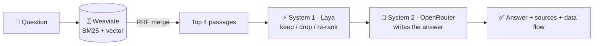

<h1 align="center">RAG with System 1 + System 2 + Hybrid Search</h1>

<p align="center">
  <b>A small, readable Spring AI demo of Retrieval-Augmented Generation</b><br>
  <i>Weaviate finds the passages (BM25 + vector), a fast System 1 model keeps the useful ones, an LLM writes the answer —
  and every step is shown.</i>
</p>

<p align="center">
  <a href="LICENSE"></a>
  
  
  
  
  
  
  
</p>

<p align="center">
  <a href="https://spring-ai-with-hybrid-search-and-system.onrender.com"><b>▶ Live demo</b></a> ·
  <a href="#how-it-works">How it works</a> ·
  <a href="#quick-start">Quick start</a> ·
  <a href="#run-locally">Run locally</a> ·
  <a href="#deploy">Deploy</a> ·
  <a href="architecture.md">Architecture</a>
</p>

---

## How it works



| Step | What happens | Code |
|---|---|---|
| 1. Retrieve | Weaviate searches by **keywords (BM25)** and by **meaning (vector)** at the same time | `HybridRetriever` |
| 2. Merge | **Reciprocal Rank Fusion**: `1/(60+rank)` from each list, added | `RrfFusion` |
| 3. Filter | **System 1** (Laya, a decision model) scores each passage: relevant? answers? prompt injection? | `SystemOneFilter` |
| 4. Generate | **System 2** (a free OpenRouter LLM) answers from the kept passages and cites them `[1]` | `SystemTwoClient` |

The app has three pages: **💬 Chat** (answers with 📚 Sources, 🔬 Trace, 🔀 Data flow), **🔎 Search Data** (compare
BM25 / Vector / Hybrid, inspect each stored record) and **🔑 Key Management**. All three services are required: if one is
down, the chat is disabled and a banner says why. Details: [architecture.md](architecture.md).

## Quick start

Only **two keys** are needed — everything else works without sign-up.

| Service | Role | You need |
|---|---|---|
| 🗄️ [Weaviate Cloud](https://console.weaviate.cloud/) | vector DB + BM25, built-in embeddings | a free cluster: REST URL + **Admin** API key |
| 🧠 [OpenRouter](https://openrouter.ai/) | System 2 (LLM), free models | an API key |
| ⚡ [Laya](https://huggingface.co/spaces/letrthang/aimtas-system-one-laya-slm) | System 1 (decision model) | nothing — public route, 10 calls/min |

1. Open 🔑 **Key Management**, enter the two keys (pick models from the dropdown — free ones first).
2. 🔎 **Search Data** → 📥 **Load sample data** (biotech, physics and a fish-farm handbook).
3. 💬 **Chat** → try *"What does Newton's second law say?"* and open 📚 Sources and 🔀 Data flow.

## Run locally

Needs **Java 25** (Maven and Node.js come with the build).

```bash
./mvnw spring-boot:run          # → http://localhost:8080
```

To skip typing keys after every restart, give them to the app **without committing them** — environment variables:

```bash
export RAGDEMO_WEAVIATE_URL=xxxx.c0.us-east-1.aws.weaviate.cloud
export RAGDEMO_WEAVIATE_KEY=...
export RAGDEMO_OPENROUTER_KEY=sk-or-v1-...
```

or a git-ignored `application-local.yml` in the project root:

```yaml
ragdemo:
  defaults:
    weaviate: { url: xxxx.c0.us-east-1.aws.weaviate.cloud, key: "..." }
    system2:  { key: "sk-or-v1-..." }
```

A key saved in 🔑 Key Management overrides these. The console logs every RAG step with timings (`DEBUG` locally;
set `RAGDEMO_LOG_LEVEL=INFO` for less). Tests: `./mvnw test` (the Weaviate test needs Docker).

## Deploy

One free **Docker** web service on **Render** ([`render.yaml`](render.yaml), [`Dockerfile`](Dockerfile)):
Render dashboard → **New → Blueprint** → this repo → **Apply**; every push to `main` redeploys. The free plan has no
persistent disk, so keys typed in the app are forgotten on a restart — enter them again.

## Licence

[Apache-2.0](LICENSE). Test cases and results: [`docs/testing/test_cases.md`](docs/testing/test_cases.md).
