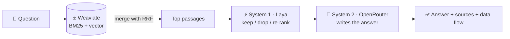

# Spring AI with Hybrid Search and System One Typesafe JEV

A small **demo / training** app. Its one purpose: show **how RAG works** with **System 1**, **System 2** and the **Weaviate** vector DB, using Spring AI and Vaadin.



1. **Retrieve:** Weaviate finds passages two ways, by keywords (**BM25**) and by meaning (**vector**), and the app merges both lists (Reciprocal Rank Fusion).
2. **System 1** (fast, small decision model): scores each passage (relevant? answers the question? prompt injection?), drops the bad ones and re-ranks the rest.
3. **System 2** (big LLM): writes the answer from the passages System 1 kept.

The 🔀 **Data flow** dialog in the app shows every step of one question, with timings.

> 🚧 Work in progress. The plan is in issue [#2](https://github.com/letrthang/spring-ai-with-hybrid-search-and-system-one-typesafe-jev/issues/2), the design in [`architecture.md`](architecture.md).

---

## What you need to start the web app

You only need **two accounts**. Everything else works out of the box.

| | Service | Default (we provide) | What you need | Bring your own? |
|---|---|---|---|---|
| 🗄️ | **Vector DB** — Weaviate | — | a free **Weaviate Cloud** cluster: its **URL** + an **Admin API key** | any Weaviate you run yourself (URL + key) |
| 🧠 | **System 2** — LLM that writes the answer | **OpenRouter**, free `…:free` models | an **OpenRouter API key** (free) | any OpenAI-compatible endpoint (e.g. Ollama) |
| ⚡ | **System 1** — decision model that filters passages | **Laya** public demo route on Hugging Face — **no key** | nothing | your own Laya server |
| ☁️ | **Hosting** | Render (free plan) | nothing to run locally | — |

Enter everything in the app's **🔑 Key Management** menu. Keys are saved in the app's local file DB and read on every API call.
On Render the disk is not persistent, so after a restart or redeploy you enter them again.

### Get the two keys

1. **OpenRouter:** sign up at [openrouter.ai](https://openrouter.ai/) → **Keys** → **Create key** (`sk-or-v1-…`). Free models still need a key; they have low per-minute and per-day limits.
2. **Weaviate Cloud:** sign in at [console.weaviate.cloud](https://console.weaviate.cloud/) → create a free **Sandbox** cluster → copy the **REST endpoint** and an **Admin** API key.
   The app creates its collection and loads the sample data, so a read-only key is not enough.
   Embeddings come from Weaviate's built-in vectorizer — no extra embedding key.

### Keys you do **not** need

| Not needed | Why |
|---|---|
| Laya / Hugging Face token | the default System 1 uses the public, keyless route |
| OpenAI / Cohere embedding key | Weaviate's built-in vectorizer makes the vectors |
| Render API key / Deploy Hook | Render deploys from GitHub on every push to `main` |
| Database password | H2 is a local file inside the app |

---

## System 1: default or your own

**Default — nothing to do.** The app calls the public Laya Space:

```
POST https://letrthang-aimtas-system-one-laya-slm.hf.space/demo/systemone
```

- No key. Limits: **10 calls / min** per IP, 1–3 questions and 2 KB per call. The app checks at most 4 passages per question, so about 2 questions a minute.
- The Space sleeps when idle and takes about a minute to wake up.
- **System 1 is required** — see [When a service is down](#when-a-service-is-down).

**Your own (optional):** run Laya yourself (`pip install "laya[serve]"` then `laya-serve` → `http://localhost:8000`) and set that URL in 🔑 Key Management → System 1 → Advanced.

## System 2: default or your own

**Default:** OpenRouter at `https://openrouter.ai/api/v1` with free models. Only the API key is needed.

**Your own (optional):** any OpenAI-compatible endpoint, e.g. Ollama (`http://localhost:11434/v1`). Set the base URL and model in 🔑 Key Management → System 2 → Advanced.

> `localhost` URLs only work when the web app runs on your own machine, not on Render.

## When a service is down

This is a demo of RAG with **all three services**, so all three are **required**: ⚡ **System 1**, 🧠 **System 2** and 🗄️ **Weaviate**. The 💬 Chat page shows a status pill for each: 🟢 Ready, 🟡 Waking up / busy / no data, or 🔴 Down.

If any one is not 🟢 Ready:
- a ⚠️ **warning banner** says which system is down and why (e.g. "System 1 is waking up, about 1 minute", "System 2: invalid key", "Weaviate: collection is empty — load sample data in 🔎 Search Data");
- the question box and **Ask** button are **disabled**, so no message is sent;
- there is **no fallback** model.

The app re-checks every 30 seconds and turns the chat back on by itself when all three are ready. If a service fails in the middle of a question, the answer stops with the same warning and the chat is disabled until the next check passes.

---

## Run

Needs **Java 25**. Maven comes with the wrapper; Node.js is downloaded by the Vaadin build.

```bash
./mvnw spring-boot:run                          # dev mode → http://localhost:8080, then open 🔑 Key Management
./mvnw package && java -jar target/ragdemo-1.0-SNAPSHOT.jar   # production build, same URL
```

The local H2 database file is `./data/ragdemo` (git-ignored). Delete the `data/` folder to forget the saved keys.
