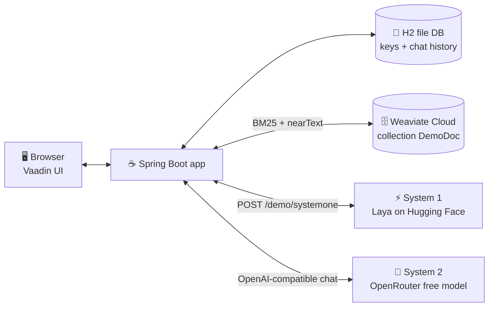
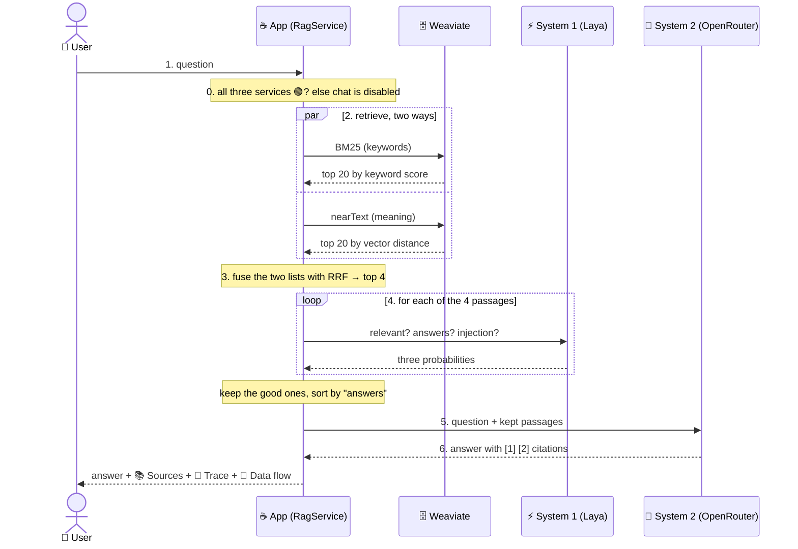

# Architecture

> **For:** developers new to RAG. **Goal:** after reading this page you can follow one question from the chat box to the
> answer, and you know which class does each step.

## 1. What the app does

A one-page Spring Boot + Vaadin web app. You type a question in **💬 Chat**. The app looks up passages in a
**Weaviate** database in two ways (keywords and meaning), asks a small fast model (**System 1**) which passages are
really useful, and asks a big model (**System 2**) to write the answer from those passages only. The 🔀 **Data flow**
dialog then shows every step that happened, with timings. **🔎 Search Data** lets you look inside Weaviate, and
**🔑 Key Management** is where you enter the two API keys the demo needs.

## 2. The big picture



| Box | What it is | Key needed? |
|---|---|---|
| 🖥️ Browser | the Vaadin page: a left drawer with 💬 Chat, 🔎 Search Data, 🔑 Key Management | — |
| ☕ Spring Boot app | all the logic; runs on Render (Docker) or `localhost:8080` | — |
| 💾 H2 file DB | `./data/ragdemo` — saved keys and chat history | — |
| 🗄️ Weaviate Cloud | the passages, with a keyword index (BM25) and vectors | ✅ URL + Admin key |
| ⚡ System 1 | **Laya**, a *decision* model: answers yes/no questions with a probability | ❌ public route |
| 🧠 System 2 | an OpenRouter **free** chat model: writes text | ✅ API key |

## 3. One question, step by step



1. **Ask.** The user types a question and presses **Ask**. The chat box is disabled while the app works.
2. **Retrieve — two ways at once.**
   - **BM25** finds passages that share the *words* of the question (good for exact names and codes such as `PCR` or `Cas9`).
   - **nearText** finds passages with the same *meaning*, even with other words ("warm water holds less oxygen" ≈ "gas solubility falls as temperature rises").
     Weaviate turns the text into a vector itself (its built-in vectorizer), so we need no embedding model.
3. **Fuse (RRF).** The two lists are merged with *Reciprocal Rank Fusion*: each passage gets
   `1 / (60 + rank)` from every list it appears in, and the scores are added. A passage high in **both** lists wins.
   The best **4** go on.
4. **System 1 — filter and re-rank.** For each passage, Laya answers three typed questions, each as a probability:

   | Question | Type | Keep the passage if |
   |---|---|---|
   | `relevant` — is this passage about the question? | yes/no | ≥ 0.45 |
   | `answers` — can it answer the question? | yes/no | ≥ 0.55 |
   | `injection` — does it try to give the reader instructions? | yes/no | < 0.70 |

   The kept passages are sorted by `answers` and the best **3** go on. The four Laya calls run in parallel
   (about 3–5 s in total). This is the same job as `JevDocumentFilter` and `JevDocumentReranker`
   in the [Spring blog post](https://spring.io/blog/2026/10/02/spring-ai-modular-rag-typesafe-jev), done by Laya.
5. **Augment.** Spring AI's `ContextualQueryAugmenter` puts the kept passages, numbered `[1]`, `[2]`…, into the prompt
   with the instruction "answer only from this context".
6. **Generate.** System 2 writes the answer. If the first free model fails, the next one in the list is tried.
7. **Show and save.** The answer, its sources, the trace and the data flow are shown and saved to the chat history.

### What the user sees under each answer

| Section | Shows |
|---|---|
| 📚 **Sources — n used of m** | every passage found: BM25 rank, vector rank, RRF score, System 1's three scores, kept or dropped |
| 🔬 **Trace** | the time of each step, which model answered, tokens used |
| 🔀 **Data flow** | a dialog with the sequence diagram above, drawn from what really happened, with ms on each arrow |

## 4. System 1 vs System 2

| | ⚡ System 1 (Laya) | 🧠 System 2 (OpenRouter LLM) |
|---|---|---|
| Thinks like | a reflex: fast, narrow | slow, careful, general |
| Input → output | a passage + a typed question → **a probability** | a prompt → **free text** |
| Speed | ~1 s per call | several seconds |
| Cost | free, small model | the expensive part (free models here, but rate-limited) |
| Job in this app | decide which passages are worth reading | write the answer |

**Why combine them?** Search always returns some junk. Sending junk to the big model costs tokens and invites wrong
answers or prompt injection. A small decision model removes it cheaply first — "you only pay for the big LLM when the
step needs one".

## 5. Vector vs BM25 vs hybrid

Example collection: *(A)* "PCR makes millions of copies of one short piece of DNA", *(B)* "Warm liquids
hold less dissolved gas than cold ones (Henry's law)".

| Question | BM25 (words) | Vector (meaning) | Hybrid (RRF) |
|---|---|---|---|
| "what does PCR do" | ✅ (A) — exact word "PCR" | 🟠 a general "DNA" passage may rank close | ✅ (A) — top of BM25 |
| "why does a warm pond run short of oxygen" | ❌ few shared words | ✅ (B) — same meaning | ✅ (B) — top of vector |

Each method misses something; the fused list gets both right. That is why the demo runs both and shows both ranks in
📚 Sources and in 🔎 Search Data.

## 6. Code map

```
src/main/java/com/example/ragdemo/
├── RagDemoApplication.java        Spring Boot entry point; Aura theme, push, light/dark
├── keys/                          🔑 the two keys and the endpoints, in the H2 file DB
│   ├── ApiSetting.java (+ repository)  one row: name → value
│   └── KeyStore.java              typed getters; defaults from application.yml / env vars;
│                                  read on EVERY call (no cached keys)
├── weaviate/                      🗄️ retrieval
│   ├── WeaviateConnector.java     the only place that opens a WeaviateClient (rebuilt when the key changes)
│   ├── DemoDocCollection.java     the collection DemoDoc (title, body, source, chunkNo) + built-in vectorizer, HFresh
│   ├── SampleDataLoader.java      resources/sample-data/*.md → one passage per "## section" → Weaviate
│   ├── HybridRetriever.java       Spring AI DocumentRetriever: BM25 + nearText in parallel + RRF
│   ├── RrfFusion.java             1/(60+rank), the whole fusion in one small class
│   ├── WeaviateRecords.java       one stored object by UUID (fields, vector, times) for 🧾 record details
│   └── WeaviateHealth.java        🟢 N passages / 🟡 empty / 🔴 down or bad key
├── system1/                       ⚡ Laya
│   ├── LayaClient.java            POST /demo/systemone: three yes/no questions → three probabilities
│   ├── SystemOneFilter.java       Spring AI DocumentPostProcessor: score every passage, keep / drop
│   ├── SystemOneReranker.java     Spring AI DocumentPostProcessor: sort the kept ones by "answers", best 3
│   └── SystemOneHealth.java       GET /health
├── system2/                       🧠 OpenRouter
│   ├── SystemTwoClient.java       Spring AI OpenAiChatModel built per call, models tried in order
│   ├── OpenRouterModels.java      the model list (🆓 free first, 💲 paid) with context size and price
│   └── SystemTwoHealth.java       GET /key (OpenRouter) or /models — costs no tokens
├── rag/                           🔗 the pipeline
│   ├── RagService.java            steps 2–7 above, top to bottom; logs every step (DEBUG)
│   ├── FlowRecorder.java          collects FlowHop records for 🔀 Data flow
│   ├── RagAnswer.java             text + sources + trace + flow (+ failure)
│   ├── Msg.java                   a text as key + arguments, translated only when shown (see i18n below)
│   ├── ServiceStatus.java         🟢 / 🟡 / 🔴 + reason, for the pills
│   ├── SystemDownException.java   a required service failed → stop
│   └── Http.java                  the one JDK HttpClient (health checks, Laya)
├── chat/                          💬 history in H2
│   ├── ChatSession.java, ChatMessage.java (+ repositories)
│   └── ChatHistoryService.java    saves each turn; the answer is kept as JSON (sources, trace, flow)
└── ui/                            🖥️ Vaadin
    ├── MainLayout.java            the page: header (title, ocean-wave border, logos, 🌐 language) + left drawer
    ├── ChatView.java              💬 status pills, question, progress steps, answers, 📂 History
    ├── AnswerBubble.java          answer + 📚 Sources + 🔬 Trace + 🔀 Data flow button
    ├── DataFlowDiagram.java       the sequence diagram, plain HTML/CSS
    ├── SearchDataView.java        🔎 BM25 / Vector / Hybrid over Weaviate, master-detail with DetailCard
    ├── RecordDialog.java          🧾 one Weaviate record: where it lives, its schema, its vector
    ├── KeyManagementView.java     🔑 the keys, with 🧪 Test buttons
    ├── ModelPicker.java           🧩 choose and order the System 2 models
    ├── Hint.java, InfoHint.java   ℹ️ the learning hints (what / does / theory / links) and their buttons
    ├── Tr.java, LanguageSetup.java  🌐 translations; every visitor starts in English
    └── AppDialog.java, DetailCard.java, StatusPill.java, Background.java (virtual thread → UI.access)

src/main/resources/
├── application.yml                defaults (keys empty → env vars or git-ignored ./application-local.yml), logging
├── sample-data/01…14-*.md         biotech, physics, the demo itself, office notes, fish farm
├── vaadin-i18n/translations.properties      🇬🇧 English (default)
├── vaadin-i18n/translations_vi.properties   🇻🇳 Tiếng Việt
├── vaadin-i18n/translations_ja.properties   🇯🇵 日本語
└── META-INF/resources/            styles.css (all rd-* classes) + icons/*.webp
```

**i18n.** Every text on the page comes from `vaadin-i18n/translations*.properties`; the three files have exactly
the same keys (`TranslationsTest` checks it). The backend never builds English sentences: it returns a `Msg`
(key + arguments, e.g. `status.http` + `503`) and the UI turns it into text with `Tr.t(...)` in the page's language.
An argument written `@key` is translated too (e.g. `flow.stopped` + `@service.SYSTEM1`). The 🌐 dropdown in the
header stores the language in the session and reloads the page. Logs stay in English.

`RagService` calls the Spring AI building blocks **one by one, in plain code**, so each step can be timed and drawn in
the data flow. Spring AI's `RetrievalAugmentationAdvisor` wires the very same pieces
(`DocumentRetriever` → `DocumentPostProcessor`s → `QueryAugmenter`) in one advisor; once you understand this file,
you understand that advisor.

## 7. Keys and configuration

| Setting | Where | Secret? |
|---|---|---|
| Weaviate URL + Admin API key | 🔑 Key Management → H2 | key: yes |
| OpenRouter API key | 🔑 Key Management → H2 | yes |
| OpenRouter models (free by default) | 🔑 Key Management → H2 | no |
| System 2 base URL (default OpenRouter), System 1 URL (default public Laya) | 🔑 Key Management → Advanced | no |

- Every API call reads its key from H2 **at the moment of the call**, so a newly saved key works at once.
- Keys are never logged, never shown in full (only `••••abcd`), never put in a trace hop, never committed.
- On Render the disk is not persistent: a restart, redeploy or wake-up starts with an empty DB → enter the keys again.

### When a service is down

All three services are required. The 💬 Chat page shows a pill for each (🟢 / 🟡 / 🔴), re-checked every 30 s. If any
is not 🟢, a ⚠️ banner says which one and why, and the question box and **Ask** are **disabled**. There is no fallback
model. If a service fails during a question, `SystemDownException` stops the pipeline and the same banner appears.

## 8. Deploy

- One **Docker** web service on **Render** (free plan): `Dockerfile` (Maven + Vaadin production build → JRE 25) and
  `render.yaml`. URL: <https://spring-ai-with-hybrid-search-and-system.onrender.com>.
- Render's GitHub App redeploys on every push to `main`. No Render key is used by the app.
- Free instances sleep after 15 minutes idle; the first visit after that takes about a minute.

## 9. Glossary

| Word | Meaning |
|---|---|
| **RAG** | Retrieval-Augmented Generation: look up passages first, then let the LLM answer from them |
| **Passage / chunk** | a small piece of a document (a few hundred tokens) stored as one Weaviate object |
| **Embedding / vector** | a list of numbers that stands for the meaning of a text; close vectors = similar meaning |
| **BM25** | the classic keyword ranking: rare words that appear often in a passage score high |
| **nearText** | Weaviate's vector search from a text query (it embeds the query for you) |
| **RRF** | Reciprocal Rank Fusion: merge ranked lists by adding `1/(60+rank)` |
| **System 1 / System 2** | fast intuitive vs slow deliberate thinking (Kahneman); here a decision model vs an LLM |
| **Jev / Laya** | System 1 decision models with the same `/v1/systemone` API; this demo uses Laya |
| **Rerank** | re-order the found passages by a better score than the search gave |
| **Augment** | add the passages to the prompt |
