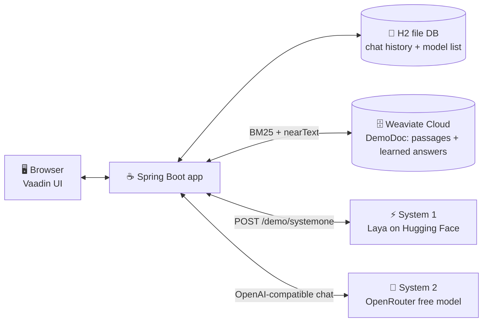
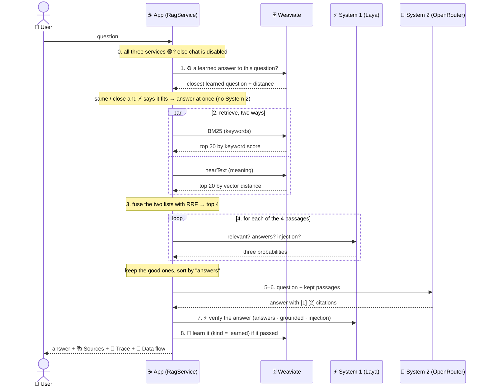

# Architecture

> **For:** developers new to RAG. **Goal:** after reading this page you can follow one question from the chat box to the
> answer, and you know which class does each step.

## 1. What the app does

A Spring Boot + Vaadin web app with three pages. You type a question in **💬 Chat**. The app looks up passages in a
**Weaviate** database in two ways (keywords and meaning), asks a small fast model (**System 1**) which passages are
really useful, and asks a big model (**System 2**) to write the answer from those passages only. The 🔀 **Data flow**
dialog then shows every step that happened, with timings.

On top of that pipeline:

- **🧠 Self-learning** — an answer that ⚡ System 1 verifies is saved; a very similar question later reuses it (♻️) without
  calling System 2.
- **🛠 Agentic mode** — a switch: System 2 gets tools (search, learned answers, chat history) and decides itself what to
  look up, as often as it needs.
- **🔎 Search Data** — look inside Weaviate (BM25 / vector / hybrid, record details, 🧱 schema), the 🧠 learned answers
  and the app's own 💾 H2 database.
- **🔑 Key Management** — use your own keys instead of the site owner's defaults (kept in memory, never shown).
- 🌐 English, Tiếng Việt, 日本語 — every text, every ℹ️ lesson, and 1,000 sample passages per language.

## 2. The big picture



| Box | What it is | Key needed? |
|---|---|---|
| 🖥️ Browser | the Vaadin page: a left drawer with 💬 Chat, 🔎 Search Data, 🔑 Key Management | — |
| ☕ Spring Boot app | all the logic; runs on Render (Docker) or `localhost:8080` | — |
| 💾 H2 file DB | `./data/ragdemo` — chat history and the System 2 model list (**never a key**) | — |
| 🗄️ Weaviate Cloud | one collection `DemoDoc`: 3,000 passages (`kind = passage`) and the learned answers (`kind = learned`), with a keyword index (BM25) and vectors | ✅ URL + Admin key |
| ⚡ System 1 | **Laya**, a *decision* model: answers yes/no questions with a probability | ❌ public route |
| 🧠 System 2 | an OpenRouter **free** chat model: writes text | ✅ API key |

## 3. One question, step by step



1. **Ask — and ♻️ reuse?** The user types a question and presses **Ask** (the chat box is disabled while the app
   works). First the app looks for a learned answer to the same or a very similar question (see *Self-learning* below);
   if ⚡ System 1 agrees it fits, that answer is returned in ~1.5 s and steps 2–8 are skipped.
2. **Retrieve — two ways at once.** Only passages in the question's language (en / vi / ja, by script) and only
   `kind = passage` objects.
   - **BM25** finds passages that share the *words* of the question (good for exact names and codes such as `PCR` or `Cas9`).
   - **nearText** finds passages with the same *meaning*, even with other words ("warm water holds less oxygen" ≈ "gas solubility falls as temperature rises").
     Weaviate turns the text into a vector itself (its built-in vectorizer), so we need no embedding model.
3. **Fuse (RRF).** The two lists are merged with *Reciprocal Rank Fusion*: each passage gets
   `1 / (60 + rank)` from every list it appears in, and the scores are added. A passage high in **both** lists wins.
   The best **4** go on.
4. **System 1 — filter and re-rank.** For each passage, Laya answers three typed questions, each as a probability:

   | Question | Type | Keep the passage if |
   |---|---|---|
   | `relevant` — is this passage about the question? | yes/no | ≥ 0.45 |
   | `answers` — can it answer the question? | yes/no | ≥ 0.55 |
   | `injection` — does it try to give the reader instructions? | yes/no | < 0.70 |

   The kept passages are sorted by `answers` and the best **3** go on. The four Laya calls run in parallel
   (about 3–5 s in total). This is the same job as `JevDocumentFilter` and `JevDocumentReranker`
   in the [Spring blog post](https://spring.io/blog/2026/10/02/spring-ai-modular-rag-typesafe-jev), done by Laya.
5. **Augment.** Spring AI's `ContextualQueryAugmenter` puts the kept passages, numbered `[1]`, `[2]`…, into the prompt
   with the instruction "answer only from this context".
6. **Generate.** System 2 writes the answer. If the first free model fails (busy, down, slow), the next one in the
   list is tried; a wrong key stops at once.
7. **Verify.** ⚡ System 1 checks the answer itself (see *Self-learning*).
8. **Learn, show and save.** A verified answer is saved as a learned object; the answer, its sources, the trace and
   the data flow are shown and saved to the chat history (H2).

### What the user sees under each answer

| Section | Shows |
|---|---|
| 📚 **Sources — n used of m** | every passage found: BM25 rank, vector rank, RRF score, System 1's three scores, kept or dropped |
| 🔬 **Trace** | the time of each step, which model answered, tokens used |
| 🔀 **Data flow** | a dialog with the sequence diagram above, drawn from what really happened, with ms on each arrow |
| 🧠 / ♻️ / 🛠 chips | learned ✅ (with System 1's scores) or why not · reused (distance, score) · agent rounds and tool calls |

### Self-learning: ♻️ reuse first, 🧠 learn last

```
question ─► ♻️ closest learned answer (kind = learned, same language, nearText on the question)
             │ (same question, or distance < 0.45) and ⚡ "does this stored answer answer THIS question?" ≥ 0.70
             ├── yes ─► answer + its original sources, marked ♻️ — System 2 not called
             └── no ──► the normal pipeline ─► answer ─► ⚡ verify ─► 🧠 save (kind = learned)
```

An answer is **learned** only if it cites a passage [n], ⚡ says it answers the question (≥ 0.70), a cited passage
supports it (≥ 0.55) and it gives no orders to an AI (injection < 0.30) — `AnswerVerifier`. Learned answers live in
`DemoDoc` too — the free Weaviate Cloud plan allows **one collection** — as objects with `kind = learned` (title = body
= the question, plus `answer`, `model`, `sources`, scores). Every passage search, list and count filters
`kind = passage`, so generated text never becomes a "fact"; 📥 Load sample data rebuilds the collection and clears them.
If System 1 is busy, the answer is simply not learned (it is still shown).

**Reuse distance 0.45.** Measured on Weaviate Cloud's vectorizer (Snowflake arctic-embed-l-v2.0, 1-bit RQ), a
question is never near 0 from itself: identical 0.33, other case / no "?" 0.38–0.40, "What is a RAS?" 0.48–0.57, other
topics 0.75–0.84. So the same question (case, spaces and end punctuation ignored) always matches, a close one matches
below 0.45, and ⚡ System 1 still has to say the stored answer answers the new question (≥ 0.70). The learned object's
UUID is made from `lang|question`, so asking the same question again replaces it instead of adding a duplicate.
🔎 Search Data → 🧠 Learned answers lists them (⛶ full screen, 🗑 forget all); double-click or right click → 🔍 Details
shows the answer, its scores, the passages it came from and the stored Weaviate object.

### 🛠 Agentic mode: System 2 picks its tools

```
question ─► 🧠 System 2 (prompt + 3 tool descriptions)
              │  replies with tool calls, e.g. search_passages("PCR qPCR difference")
              ▼
           ☕ App runs each call ── search_passages ──► 🗄️ Weaviate ─► ⚡ System 1 keeps / drops ─► kept passages [n]
              │                 ── find_learned_answer ─► 🗄️ kind = learned ─► ⚡ fits? ─► answer + its passages [n]
              │                 ── recent_questions ──► 💾 H2 (SELECT, read-only)
              ▼
           🧠 System 2 (conversation + tool results) … repeat — at most 6 tool calls; the last round has no tools
              ▼
           answer citing [n] ─► ⚡ verify ─► 🧠 learn          (same as the pipeline)
```

`RagAgent` runs this loop itself: `SystemTwoClient.step` sends the conversation and the `ToolCallback`s to the
**`ChatModel`** (not `ChatClient`, whose tool-calling advisor would run the tools for us), the model answers with
`AssistantMessage.ToolCall`s, the app calls each `ToolCallback`, adds a `ToolResponseMessage` and asks again. That is
how every call is timed, drawn in 🔀 Data flow, checked by System 1 and limited. Passages keep one number [n] for the
whole question. A required service that fails before any passage was checked stops the question (fail closed); later,
the tool tells the agent "not available, answer from what you have" — unchecked text never reaches the model.

## 4. System 1 vs System 2

| | ⚡ System 1 (Laya) | 🧠 System 2 (OpenRouter LLM) |
|---|---|---|
| Thinks like | a reflex: fast, narrow | slow, careful, general |
| Input → output | a passage + a typed question → **a probability** | a prompt → **free text** |
| Speed | ~1 s per call | several seconds |
| Cost | free, small model | the expensive part (free models here, but rate-limited) |
| Job in this app | decide which passages are worth reading | write the answer |

**Why combine them?** Search always returns some junk. Sending junk to the big model costs tokens and invites wrong
answers or prompt injection. A small decision model removes it cheaply first — "you only pay for the big LLM when the
step needs one".

## 5. Vector vs BM25 vs hybrid

Example collection: *(A)* "PCR makes millions of copies of one short piece of DNA", *(B)* "Warm liquids
hold less dissolved gas than cold ones (Henry's law)".

| Question | BM25 (words) | Vector (meaning) | Hybrid (RRF) |
|---|---|---|---|
| "what does PCR do" | ✅ (A) — exact word "PCR" | 🟠 a general "DNA" passage may rank close | ✅ (A) — top of BM25 |
| "why does a warm pond run short of oxygen" | ❌ few shared words | ✅ (B) — same meaning | ✅ (B) — top of vector |

Each method misses something; the fused list gets both right. That is why the demo runs both and shows both ranks in
📚 Sources and in 🔎 Search Data.

## 6. Code map

```
src/main/java/com/example/ragdemo/
├── RagDemoApplication.java        Spring Boot entry point; Aura theme, push, light/dark
├── keys/                          🔑 the keys and endpoints of the three services
│   ├── ApiSetting.java (+ repository)  one H2 row: name → value — only the System 2 model list
│   └── KeyStore.java              typed in 🔑 → memory only (never H2, never shown) → else env defaults
│                                  (RAGDEMO_*) → else built-in; read on EVERY call (no cached keys)
├── weaviate/                      🗄️ retrieval
│   ├── WeaviateConnector.java     the only place that opens a WeaviateClient (rebuilt when the key changes);
│   │                              closes it only for a broken connection, retries a stale one once
│   ├── DemoDocCollection.java     DemoDoc: title, body, source, chunkNo, lang, kind (passage | learned) + answer,
│   │                              model, sources, scores; built-in vectorizer on title + body, HFresh index
│   ├── SampleDataLoader.java      sample-data/<lang>/*.md (in file-number order) → one passage per "## section"
│   │                              → drops the collection, inserts in batches of 200
│   ├── HybridRetriever.java       Spring AI DocumentRetriever: BM25 + nearText in parallel + RRF
│   ├── RrfFusion.java             1/(60+rank), the whole fusion in one small class
│   ├── WeaviateRecords.java       one stored object by UUID (fields, vector, times) for 🧾 record details
│   ├── WeaviateSchema.java        GET /v1/schema/DemoDoc, read live for the 🧱 Schema dialog
│   ├── Lang.java                  en / vi / ja of a question (by script) → searches keep to that language
│   ├── LearnedAnswers.java        🧠 kind = learned objects: closest question · same question? · save (one per
│   │                              lang + question) · list · count · forget
│   └── WeaviateHealth.java        🟢 N passages / 🟡 empty or loaded by an older version / 🔴 down or bad key
├── system1/                       ⚡ Laya
│   ├── LayaClient.java            POST /demo/systemone via RestClient: yes/no questions about a text → probabilities
│   ├── AnswerVerifier.java        ⚡ checks ANSWERS: before learning (answers · grounded · injection) and before reuse
│   ├── SystemOneFilter.java       Spring AI DocumentPostProcessor: score every passage, keep / drop
│   ├── SystemOneReranker.java     Spring AI DocumentPostProcessor: sort the kept ones by "answers", best 3
│   └── SystemOneHealth.java       GET /health
├── system2/                       🧠 OpenRouter
│   ├── SystemTwoClient.java       Spring AI OpenAiChatModel; one OpenAI client pair per key (stale ones closed first);
│   │                              step(): one 🛠 agent round — conversation + tools → text or tool calls
│   ├── OpenRouterModels.java      the model list (🆓 free first, 💲 paid) with context size and price
│   └── SystemTwoHealth.java       GET /key (OpenRouter) or /models — costs no tokens
├── rag/                           🔗 the pipeline
│   ├── RagService.java            the steps above, top to bottom (+ ♻️ reuse first, 🧠 learn last); logs every step
│   ├── RagAgent.java              🛠 agentic mode: the tool loop and its 3 @Tool methods (search · learned · H2)
│   ├── FlowRecorder.java          collects FlowHop records for 🔀 Data flow (lifelines: User, App, Weaviate,
│   │                              System 1, System 2, + 💾 H2 when the agent reads it)
│   ├── RagAnswer.java             text + sources + trace + flow (+ failure, ♻️ reuse, 🧠 learning, 🛠 agent)
│   ├── Msg.java                   a text as key + arguments, translated only when shown (see i18n below)
│   ├── ServiceStatus.java         🟢 / 🟡 / 🔴 + reason, for the pills
│   ├── SystemDownException.java   a required service failed → stop
│   └── Http.java                  the one JDK HttpClient (one pool) + RestClient on top of it
├── db/                            💾 the app's own database
│   └── DatabaseBrowser.java       tables from INFORMATION_SCHEMA, pages of rows, parameterised UPDATE / DELETE
├── chat/                          💬 history in H2
│   ├── ChatSession.java, ChatMessage.java (+ repositories)
│   └── ChatHistoryService.java    saves each turn; the answer is kept as JSON (sources, trace, flow);
│                                  recentQuestions() for the 🛠 agent (read-only)
└── ui/                            🖥️ Vaadin
    ├── MainLayout.java            the page: header (title, ocean-wave border, logos, 🌐 language) + left drawer
    ├── ChatView.java              💬 status pills, 🧭 diagram, question + 🛠 Agentic mode switch, progress steps,
    │                              answers, 📂 History
    ├── SystemMap.java             server side of <rd-system-map> (src/main/frontend/rd-system-map.ts, Lit):
    │                              live status, ♻️ reuse / 🧠 learn branches, 🛠 tool loop when agentic
    ├── AnswerBubble.java          answer + 🛠 / ♻️ / 🧠 chips + 📚 Sources + 🔬 Trace + 🔀 Data flow button
    ├── DataFlowDiagram.java       the sequence diagram, plain HTML/CSS (5 lifelines, 6 with 💾 H2)
    ├── SearchDataView.java        🔎 BM25 / Vector / Hybrid over Weaviate, master-detail with DetailCard
    ├── RecordDialog.java          🧾 one Weaviate record, laid out like the Weaviate console (JSON / fields)
    ├── SchemaDialog.java          🧱 the collection schema, live from /v1/schema
    ├── LearnedCard.java           🧠 the learned answers (lazy grid, ⛶ full screen, 🗑 forget all)
    ├── LearnedDialog.java         🔍 one learned answer: scores, its passages, the stored object (double-click /
    │                              right click → Details…)
    ├── DatabaseCard.java          💾 H2 tables: read, edit, delete a row, ⛶ full screen
    ├── SplitMasterDetail.java     grid | card with a draggable splitter
    ├── KeyManagementView.java     🔑 the keys (never shown), 🧪 Test, ● online badges (StatusBadge)
    ├── ModelPicker.java           🧩 choose and order the System 2 models
    ├── Hint.java, InfoHint.java   ℹ️ the learning hints (what / does / theory / links) and their buttons
    ├── Tr.java, LanguageSetup.java  🌐 translations; every visitor starts in English
    ├── ErrorHandling.java         every UI error logged + shown; a closed browser is not an error
    └── AppDialog.java, DetailCard.java, StatusPill.java, Background.java (virtual thread → UI.access)

src/main/frontend/
└── rd-system-map.ts               🧭 the "How it works" diagram, a Lit web component

src/main/resources/
├── application.yml                defaults (keys empty → env vars or git-ignored ./application-local.yml), logging
├── sample-data/{en,vi,ja}/*.md    110 files × 10 sections = 1,000 passages per language (the same files, translated):
│                                  biotech, physics, RAS / fish farm (incl. AI monitoring), demo, office notes
├── vaadin-i18n/translations.properties      🇬🇧 English (default)
├── vaadin-i18n/translations_vi.properties   🇻🇳 Tiếng Việt
├── vaadin-i18n/translations_ja.properties   🇯🇵 日本語
└── META-INF/resources/            styles.css (all rd-* classes) + icons/*.webp
```

**i18n.** Every text on the page comes from `vaadin-i18n/translations*.properties`; the three files have exactly
the same keys (`TranslationsTest` checks it). The backend never builds English sentences: it returns a `Msg`
(key + arguments, e.g. `status.http` + `503`) and the UI turns it into text with `Tr.t(...)` in the page's language.
An argument written `@key` is translated too (e.g. `flow.stopped` + `@service.SYSTEM1`). The 🌐 dropdown in the
header stores the language in the session and reloads the page. Logs stay in English.

## 7. Spring AI — the main classes

Spring AI (`spring-ai-rag` + `spring-ai-openai`, version 2.0.1) gives the app its RAG building blocks. These are the
classes to learn first, in the order a question meets them:

| Class (package `org.springframework.ai…`) | What it is | Where it is used here |
|---|---|---|
| `document.Document` | One piece of text + an id + a `metadata` map (+ an optional score). The unit that moves through RAG. | `HybridRetriever` builds one per passage; `SystemOneFilter` adds the Laya scores and the verdict to its metadata |
| `rag.Query` | The user's question as an object (text + history + context). Every RAG step takes one. | `RagService`: `new Query(question)` |
| `rag.retrieval.search.DocumentRetriever` | Interface: `Query` → `List<Document>`. "Find passages for this question." | `HybridRetriever` — BM25 + nearText in Weaviate, merged with RRF |
| `rag.postretrieval.document.DocumentPostProcessor` | Interface: `(Query, List<Document>)` → `List<Document>`. Filter, rerank or shorten the found passages. | `SystemOneFilter` (⚡ keep / drop), `SystemOneReranker` (⚡ sort by "answers", keep 3) |
| `rag.generation.augmentation.ContextualQueryAugmenter` | Puts the passages into the prompt: `augment(Query, List<Document>)` → a new `Query` whose text is the full prompt. | `RagService` step 5, with our own template and a formatter that numbers the passages `[1]`, `[2]`… |
| `chat.prompt.PromptTemplate` | A text with `{placeholders}` filled at run time. | `RagService.PROMPT` — `{context}` + `{query}`, rules: cite `[n]`, say "I don't know" |
| `chat.model.ChatModel` / `openai.OpenAiChatModel` | The connection to an LLM. `OpenAiChatModel` speaks the OpenAI API, so it works with OpenRouter by changing the base URL. | `SystemTwoClient` builds one **per call** (key read from H2 at that moment) |
| `openai.OpenAiChatOptions` | Settings for one model: base URL, API key, model name, timeout, retries. | `SystemTwoClient`: one model at a time, `maxRetries(0)` so we move on to the next model ourselves |
| `chat.client.ChatClient` | The fluent API on top of a `ChatModel`: `.prompt().system(…).user(…).call()`. | `SystemTwoClient` — sends the augmented prompt |
| `chat.model.ChatResponse` + `chat.metadata.Usage` | The answer text plus metadata: model used, prompt / completion tokens. | `SystemTwoClient` → 🔬 Trace (`tokens in / out`) |
| `tool.annotation.Tool` / `ToolParam`, `support.ToolCallbacks`, `tool.ToolCallback` | A Java method the LLM may call: name, description and JSON parameters are generated from the method; `ToolCallbacks.from(object)` turns its `@Tool` methods into callbacks. | `RagAgent.Tools` — `search_passages`, `find_learned_answer`, `recent_questions` |
| `chat.messages.AssistantMessage.ToolCall`, `ToolResponseMessage` | The model's request to call a tool, and the app's answer to it, added to the conversation. | `RagAgent.run` — the agent loop (🛠 agentic mode) |

How they fit together, as Spring AI sees the chain:

```java
Query query = new Query(question);
List<Document> found = retriever.retrieve(query);                          // DocumentRetriever       🗄️
List<Document> kept  = filter.process(query, found);                       // DocumentPostProcessor   ⚡ keep / drop
List<Document> best  = reranker.process(query, kept);                      // DocumentPostProcessor   ⚡ best 3
Query prompt = ContextualQueryAugmenter.builder()
        .promptTemplate(PROMPT).documentFormatter(RagService::numbered)
        .build().augment(query, best);                                    // QueryAugmenter          ✍️
ChatResponse answer = ChatClient.create(chatModel).prompt()
        .system(SYSTEM_PROMPT).user(prompt.text()).call().chatResponse(); // ChatClient → OpenAiChatModel 🧠
```

`RagService` runs these **one by one, in plain code**, so each step can be timed, logged and drawn in 🔀 Data flow.
For the first two steps it calls the richer twins of the interface methods — `HybridRetriever.search(…)` and
`SystemOneFilter.score(…)` — which do the same work but also return the timings and the dropped passages for
📚 Sources; `retrieve` and `process` stay so the classes plug into any Spring AI RAG setup.
Spring AI's `RetrievalAugmentationAdvisor` wires the very same pieces (`DocumentRetriever` →
`DocumentPostProcessor`s → `QueryAugmenter`) inside one `ChatClient` advisor; once you understand `RagService`, you
understand that advisor.

**Not used, on purpose:** `VectorStore` / `WeaviateVectorStore` (vector search only, no BM25 — so `HybridRetriever`
uses the Weaviate client directly); `QueryTransformer` / `MultiQueryExpander` (rewriting the question — a good next
step, kept out to stay simple); `ChatMemory` (chat history is saved by `ChatHistoryService` in H2 instead);
`ToolCallingAdvisor` (ChatClient's built-in tool loop — `RagAgent` runs the loop itself to time, draw and limit every
call).

### 7.1 Which Spring AI classes handle each feature

| Feature | Spring AI classes | Our classes |
|---|---|---|
| 🔗 **Fixed RAG pipeline** (search → ⚡ → 🧠) | `Document`, `Query`, `DocumentRetriever`, `DocumentPostProcessor`, `ContextualQueryAugmenter`, `PromptTemplate`, `ChatClient` | `HybridRetriever`, `SystemOneFilter`, `SystemOneReranker`, `RagService` |
| 🧠 **System 2 + model fallback** | `OpenAiChatModel`, `OpenAiSetup` (the OpenAI SDK clients), `OpenAiChatOptions` (model per call), `ChatResponse`, `Usage` | `SystemTwoClient` |
| 🧠♻️ **Self-learning** | `Document` (the cited passages travel as Documents and are saved with the answer) — the cache itself is not a Spring AI feature | `AnswerVerifier`, `LearnedAnswers`, `RagService.tryReuse / learn` |
| 🛠 **Agentic mode** (tool calling) | `@Tool`, `@ToolParam`, `ToolCallbacks`, `ToolCallback`, `ToolCallResultConverter`, `Prompt`, `SystemMessage`, `UserMessage`, `AssistantMessage.ToolCall`, `ToolResponseMessage`, `ChatModel.call(Prompt)` | `RagAgent`, `SystemTwoClient.step` |

**🔗 Fixed pipeline** — our classes implement Spring AI's RAG interfaces, so they also plug into
`RetrievalAugmentationAdvisor`:

```java
public class HybridRetriever implements DocumentRetriever {           // Query → List<Document>
    public List<Document> retrieve(Query query) { … BM25 + nearText in parallel, RRF … }
}
public class SystemOneFilter implements DocumentPostProcessor {       // keep / drop with Laya's three scores
    public List<Document> process(Query query, List<Document> documents) { … }
}
Query prompt = ContextualQueryAugmenter.builder()
        .promptTemplate(PROMPT)                                       // PromptTemplate: {context} + {query}
        .documentFormatter(RagService::numbered)                     // "[1] title\nbody"
        .build().augment(new Query(question), best);
```

**🧠 System 2 + model fallback** — one pair of OpenAI SDK clients per base URL + key (closed when the key changes),
the model chosen per call; we loop over the models ourselves (`maxRetries(0)`):

```java
OpenAIClient sync = OpenAiSetup.setupSyncClient(baseUrl, key, …, PER_MODEL_TIMEOUT, 0 /* retries */, …);
ChatModel model = OpenAiChatModel.builder().openAiClient(sync).openAiClientAsync(async).build();

for (String m : keys.system2Models()) {                               // 429 / 5xx / timeout → next model
    ChatResponse r = ChatClient.create(model).prompt().system(system).user(user)
            .options(OpenAiChatOptions.builder().model(m)).call().chatResponse();
    Usage usage = r.getMetadata().getUsage();                         // tokens in / out → 🔬 Trace
}
```

**🧠♻️ Self-learning** — Spring AI has no "answer cache", so this part is ours: Laya (`AnswerVerifier`) checks the
answer, the Weaviate client stores it (`LearnedAnswers`, `kind = learned`). Spring AI's role is the `Document`: the
passages System 2 was given are Documents, and their text, title and source are saved with the answer, so a reused
answer shows its original 📚 Sources.

**🛠 Agentic mode** — tools are plain Java methods; Spring AI turns them into JSON-described callbacks:

```java
final class Tools {
    @Tool(name = "search_passages", resultConverter = PlainText.class,
          description = "Search the knowledge base … System 1 checks every passage … Returns the kept passages")
    public String searchPassages(@ToolParam(description = "What to search for") String query) { … }
    // find_learned_answer(question), recent_questions(limit)
}
List<ToolCallback> callbacks = List.of(ToolCallbacks.from(tools));   // name + description + JSON schema each
```

The loop runs in `RagAgent`, against the **`ChatModel`** — so the model only *asks* for tools and the app decides
when and how to run them (`ChatClient` would run them itself through its `ToolCallingAdvisor`):

```java
List<Message> conversation = new ArrayList<>(List.of(new SystemMessage(SYSTEM_PROMPT), new UserMessage(question)));
for (int round = 1; ; round++) {
    Prompt prompt = new Prompt(conversation, OpenAiChatOptions.builder().model(m).toolCallbacks(callbacks).build());
    AssistantMessage reply = chatModel.call(prompt).getResult().getOutput();        // SystemTwoClient.step
    if (!reply.hasToolCalls()) return reply.getText();                              // the final answer
    conversation.add(reply);
    List<ToolResponse> results = new ArrayList<>();
    for (AssistantMessage.ToolCall call : reply.getToolCalls()) {                   // timed, drawn, limited (≤ 6)
        results.add(new ToolResponse(call.id(), call.name(), byName.get(call.name()).call(call.arguments())));
    }
    conversation.add(ToolResponseMessage.builder().responses(results).build());
}
```

`ToolCallResultConverter`: the default converter JSON-encodes a returned `String` (`"\"[1] …\\n…\""`); `PlainText`
hands the text to the model as written. A model without tool support answers 404 on OpenRouter and is skipped like a
busy one.

## 8. Keys and configuration

| Setting | Where | Secret? |
|---|---|---|
| Weaviate URL + Admin API key | 🔑 Key Management → **memory only** · default: env `RAGDEMO_WEAVIATE_URL`, `RAGDEMO_WEAVIATE_KEY` | key: yes |
| OpenRouter API key | 🔑 Key Management → **memory only** · default: env `RAGDEMO_OPENROUTER_KEY` | yes |
| OpenRouter models (free by default) | 🔑 Key Management → H2 | no |
| System 2 base URL (default OpenRouter), System 1 URL + key (default the public, keyless Laya) | 🔑 Key Management → Advanced → memory only | key: yes |

- Order of a value: **typed in 🔑 Key Management** (held in memory: never written to H2, gone after a restart) →
  else the **environment default** (set on Render under Environment; locally in the git-ignored
  `./application-local.yml`) → else the built-in default. 🗑 Clear forgets the typed one, so the default applies again.
- Every API call asks `KeyStore` **at the moment of the call**, so a newly typed key works at once.
- Keys are never logged, never shown (not even in part — the page only says "🔒 default (set by the site owner)" or "🔑 your key is in use (hidden)"), never
  put in a trace hop, never committed. The owner's default Weaviate host is masked too.

### When a service is down

All three services are required. The 💬 Chat page shows a pill for each (🟢 / 🟡 / 🔴), re-checked every 30 s. If any
is not 🟢, a ⚠️ banner says which one and why, and the question box and **Ask** are **disabled**. There is no fallback
model. If a service fails during a question, `SystemDownException` stops the pipeline and the same banner appears.

## 9. Deploy

- One **Docker** web service on **Render** (free plan): `Dockerfile` (Maven + Vaadin production build → JRE 25) and
  `render.yaml`. URL: <https://spring-ai-with-hybrid-search-and-system.onrender.com>.
- Render's GitHub App redeploys on every push to `main`. No Render key is used by the app.
- Releases follow **git flow** (from 1.0.0): features → `develop`; `release/x.y.z` → `main` + tag `vx.y.z`; hotfixes
  `hotfix/x.y.z` from `main`. So the live site runs the latest release; the H2 disk is wiped on each deploy (chat
  history), Weaviate is not.
- Free instances sleep after 15 minutes idle; the first visit after that takes about a minute.

## 10. Glossary

| Word | Meaning |
|---|---|
| **RAG** | Retrieval-Augmented Generation: look up passages first, then let the LLM answer from them |
| **Passage / chunk** | a small piece of a document (a few hundred tokens) stored as one Weaviate object |
| **Embedding / vector** | a list of numbers that stands for the meaning of a text; close vectors = similar meaning |
| **BM25** | the classic keyword ranking: rare words that appear often in a passage score high |
| **nearText** | Weaviate's vector search from a text query (it embeds the query for you) |
| **RRF** | Reciprocal Rank Fusion: merge ranked lists by adding `1/(60+rank)` |
| **System 1 / System 2** | fast intuitive vs slow deliberate thinking (Kahneman); here a decision model vs an LLM |
| **Jev / Laya** | System 1 decision models with the same `/v1/systemone` API; this demo uses Laya |
| **Rerank** | re-order the found passages by a better score than the search gave |
| **Augment** | add the passages to the prompt |
| **Learned answer** | an answer ⚡ System 1 verified, saved in Weaviate (`kind = learned`) and reused for the same or a close question |
| **Tool calling** | the LLM answers with "call this function with these arguments" instead of text; the app runs it and sends the result back |
| **Agent** | an LLM that decides its own steps with tools, in a loop, until it can answer |
